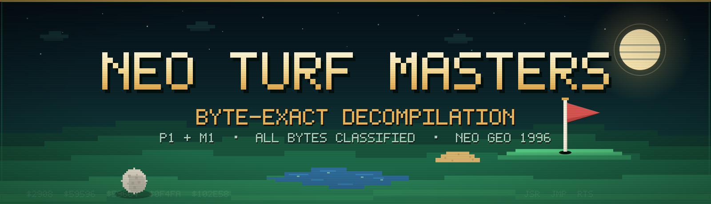

<p align="center">
  
</p>

<p align="center">
  <a href="#status"></a>
  <a href="#status"></a>
  <a href="#semantic-review"></a>
  <a href="LICENSE"></a>
  <a href="#rights"></a>
</p>

<p align="center"><em>Two hand-written program ROMs, recovered as readable assembly and rebuilt byte for byte.</em></p>

This is a byte-exact decompilation of **Neo Turf Masters / Big Tournament
Golf** (Nazca, 1996) for the Neo Geo. It targets the `turfmast` `200-` ROM
set.

The recovered source corpus and rebuild pipeline aren't published. This
repository has the documentation, classification metadata and tooling. It
doesn't distribute a ROM image, a byte-exact data section or a rebuilt ROM
set.

The decompilation is finished. Every byte of P1 and M1 has an evidence-backed
category, and the rebuild matches both original images byte for byte.

## Status

| | P1 — 68000 game program | M1 — Z80 sound driver |
|---|---|---|
| ROM | `200-p1.p1`, 2 MiB | `200-m1.m1`, 128 KiB |
| Classified | **2,097,152 / 2,097,152 bytes (100%)** | **131,072 / 131,072 bytes (100%)** |
| Unknown bytes | 0 | 0 |
| Open evidence items | 0 | 0 |
| Sources | 1,082 functions + 335 flow-recovered blocks + 9 generated data sections | 18 functions + 310 flow-recovered blocks |
| Proven dead | 4,902 bytes (3,252 code + 1,650 data) | 28 bytes of code |
| Byte match | full-image SHA-256 matches `dc56f3ee…` | full-image SHA-256 matches `8b051ac7…` |

The original is hand-written assembly, not compiled C. The census in
[docs/ORIGIN.md](docs/ORIGIN.md) found no C calling convention, prologue or
code-generation idiom anywhere in the corpus, and no compiler fingerprint
survives in the nine other Neo Geo titles sampled from 1990–2001. We measured
the matching-C idea anyway; it's a documented negative, written up in
[docs/C_MATCHING.md](docs/C_MATCHING.md).

## What "100%" means

Every byte has a category backed by evidence:

| Category | P1 bytes | M1 bytes | Meaning |
|---|---:|---:|---|
| Live code | 142,908 | 14,384 | Assembled functions and flow-recovered blocks |
| Named data | 270,568 | — | Tables and assets with consumer evidence |
| Extracted assets | 729,650 | 96,501 | Consumer-evidenced data emitted from the verified ROM |
| Fill | 949,124 | 20,159 | Constant runs proven unreferenced |
| Dead code | 3,252 | 28 | Proven unreachable by the closed-world proof |
| Dead data | 1,650 | — | Proven unreadable by any live instruction |
| **Total** | **2,097,152** | **131,072** | |

Code is recovered as readable assembly and reassembled at its real address;
each span is byte-diffed. Named data and extracted assets are classified, not
retyped: each span is a one-line claim in `config/regions/<cpu>/*.tsv` with
its consumer evidence or format proof. The rebuild emits the bytes from the
verified dump.

Fill is only fill when nothing references into it. Dead means proven dead by
the closed-world reachability proof, not "we haven't found a reference yet."

Byte-exact is a claim about reconstruction, not authorship, and not a claim
that every byte is code. Reassembling the recovered sources and re-emitting
the classified data reproduces the original images exactly.

## Use it

You need Python 3.12+, `make`, and (for `make setup`) a C compiler, `curl` and
`tar`. Install the test dependency with `pip install -r requirements.txt`.
`make verify-rom` is optional and needs your own `turfmast` dump.

```sh
git clone https://github.com/blakebratcher/ntm-decomp.git
cd ntm-decomp
python3 -m pip install -r requirements.txt
make setup      # fetch + build pinned vasm 2.0f (68000 + Z80)
make test       # corpus-independent public suite
make check      # audit + test
```

There's no playable ROM here. `make verify-rom` checks the nine files of a
user-supplied dump against [`config/rom.sha256`](config/rom.sha256) and
stages them under the gitignored `build/`. Any hash mismatch aborts.

```sh
make NTMD_ROM=/path/to/turfmast.zip verify-rom
```

## Targets

| Target | What it does | Needs ROM |
|---|---|:---:|
| `make setup` | Fetch and build vasm 2.0f (`vasmm68k_mot`, `vasmz80_std`) | — |
| `make verify-rom` | Verify a user-supplied `200-` dump against the SHA-256 pins | yes |
| `make extract` | Alias for `verify-rom` | yes |
| `make test` | Run the 21-module corpus-independent public suite | — |
| `make check` | `make audit` followed by `make test` | — |
| `make audit` | Enforce the public tree allowlist and leak checks | — |
| `make clean` | Remove `build/` | — |

The rebuild, import, completion, progress, symbolize and C-matching targets
aren't here. `make` prints a clear message for them.

## How it was verified

1. **Span gate.** Every source declares its real CPU address with `org` and is
   assembled with vasm. The build patches each assembled span over the
   pristine image and byte-diffs it.
2. **Whole-image gate.** The rebuilt `200-p1.p1` and `200-m1.m1` must match the
   SHA-256 pins in [`config/rom.sha256`](config/rom.sha256).
3. **Completeness gate.** The completion check fails while any byte is
   unclassified or any `unref` row is open. Fill may not overlap code or data.
4. **Closed world.** The reachability proof starts at the cartridge vectors and
   BIOS entry points and follows all 42 indirect transfers, each with a
   complete target set in `config/indirect_targets.tsv`. Anything it can't
   reach has to be marked and proven dead.
5. **Runtime evidence.** Every instruction start MAME actually executed
   (`config/executed_starts.tsv`) must be an instruction start in the corpus.
   That separates real execution from 68000 prefetch fetches.
6. **Invariants.** The full suite (582 tests) enforces one owner per byte, no
   code/data contradiction, unique names, valid region evidence, symbol
   consistency and the reachability proof. The public suite keeps the
   corpus-independent subset: 21 modules.

Public CI runs `make audit`, `make setup` and `make test` only. It needs no ROM
and never builds one.

## Layout

```text
config/
  rom.sha256              SHA-256 pins for the nine ROM files
  functions.tsv           function inventory (addresses, sizes, names)
  regions/<cpu>/*.tsv     byte classifications with evidence, one span per row
  names.tsv, names/*.tsv  P1 code/data names, one table per recovery lane
  ram/, m1/               P1 RAM + hardware names; M1 symbols kept separately
  indirect_targets.tsv    complete target set for every indirect call/jump
  install_proofs.tsv      proven state-install sites
  data_regions.tsv        names and sizes for the classified data sections
  data_region_notes/      detailed comment blocks for those sections
  executed_starts.tsv     MAME-recorded executed instruction starts
docs/                     methodology, provenance, subsystem write-ups, findings
docs/assets/              original README banner (SVG)
tools/                    extraction, import, evidence and verification tools
tests/                    21 corpus-independent test modules
```

## Docs

| Document | What it covers |
|---|---|
| [`docs/METHOD.md`](docs/METHOD.md) | Terminology, byte-exactness and the evidence standard |
| [`docs/ORIGIN.md`](docs/ORIGIN.md) | Why the original is hand-written assembly |
| [`docs/C_MATCHING.md`](docs/C_MATCHING.md) | The matching-C negative and semantic models |
| [`docs/DIVIDE_ANALYSIS.md`](docs/DIVIDE_ANALYSIS.md) | The shared Nazca divide kernel |
| [`docs/RUNTIME_FINDINGS.md`](docs/RUNTIME_FINDINGS.md) | Runtime findings and corrected readings |
| [`docs/memory-map.md`](docs/memory-map.md) | Neo Geo address map, P-ROM layout and banking |
| [`docs/m1.md`](docs/m1.md) | M1 architecture and driver-family identification |
| [`docs/m1-sequence-format.md`](docs/m1-sequence-format.md) | Decoded Z80 sequence command format |
| [`docs/subsystems/`](docs/subsystems/) | Per-subsystem write-ups |
| [`docs/TOOLING.md`](docs/TOOLING.md) | Toolchain pins, provenance and licenses |

## Findings

- The original is hand-written assembly. Zero `link`/`unlk`, zero
  stack-argument reads, heterogeneous entries, shared tails, and forward
  branches overwhelmingly `.w`-sized. It matches the Nazca house style, not
  compiler output ([`docs/ORIGIN.md`](docs/ORIGIN.md)).
- The divide kernel is shared across Nazca titles. The 782-byte body after the
  zero checks at 0x2908 is byte-identical in `turfmast`, `mslug2` and
  `mslugx`; only the entry branches differ
  ([`docs/DIVIDE_ANALYSIS.md`](docs/DIVIDE_ANALYSIS.md)).
- The M1 driver is an in-house Nazca code base. It shares 92.7% of its code
  window with Metal Slug's unsigned Nazca-1996 driver, not with the signed
  MAKOTO/Mr.Pac families ([`docs/m1.md`](docs/m1.md)).
- An inputs-only MAME harness played 141 hole advances across 15 scenarios,
  including 1P and 2P rounds, a challenger join, a stroke-limit failure and the
  how-to-play demo ([`docs/RUNTIME_FINDINGS.md`](docs/RUNTIME_FINDINGS.md)).
- `fixed_div_scaled` at 0x63504 divides by zero for 16 depth values. Two
  minimum-power putter shots on course 1 hole 1 trigger a trap, a hang and a
  watchdog reset ([`docs/RUNTIME_FINDINGS.md`](docs/RUNTIME_FINDINGS.md)).

## Semantic review

The semantic ledger holds 2,394 obligations: 2,391 reviewed and 3 accepted
residuals, with no unreviewed or stale records. The three residuals are open
whole-program reachability questions, not unknown bytes:

1. Can `path_sprite_step`'s stale-stream branch (0x9e0) ever resume a
   non-stream pointer into an invalid frame?
2. After a camera ratchet, is the exit step at most `$20` on every zone line?
   (0x59596 and 0x59604.)

## FAQ

**Is the ROM included?**
No. Bring your own dump for `make verify-rom`.

**Can I build a playable ROM?**
No. The source corpus and rebuild pipeline aren't published.

**Is this a decompilation or a disassembly?**
The output is assembly because the original is hand-written assembly. It isn't
a raw disassembly listing: every byte is classified, named and commented, and
the code reassembles byte-identically. "Byte-exact assembly decompilation" or
"source reconstruction" is the precise term. "Decompilation" here doesn't imply
that a compiler was used.

**What does byte-exact mean?**
The rebuilt images match the original full-image SHA-256 pins. It doesn't mean
every byte is code, and it doesn't mean the original was compiler output.
Separately, the completion gate proves that every byte has an evidence-backed
classification.

**Why assembly instead of C?**
Because the original is assembly. The compiler census found no C calling
convention, prologue or idiom in this ROM or in nine other sampled Neo Geo
titles. GCC and stock vbcc can't byte-match the four phase-3 attempts, and a
purpose-patched vbcc backend matches 0 of the ten screened candidates. See
[`docs/ORIGIN.md`](docs/ORIGIN.md) and
[`docs/C_MATCHING.md`](docs/C_MATCHING.md).

**Is the C matching done?**
Not as a byte-matching C decompilation. That goal is structurally blocked in
the available backends, and since the original is hand-written assembly there's
no original C to recover. A verified suite of semantic C models covers 16 pure
functions.

**How are code and data distinguished?**
Static roots at the cartridge vectors and BIOS entry points, closed-world
reachability with complete indirect target sets, MAME CURPC execution evidence,
table-format proofs and dead-code proofs. Every span carries its evidence in
`config/regions/`. A play-through is one runtime input, not the classification
method.

**What is still unknown?**
No bytes. Three whole-program reachability questions are accepted residuals;
see [Semantic review](#semantic-review).

## Rights

This is a non-commercial research and preservation project, built from the
owner's own ROM dump. It isn't affiliated with or endorsed by SNK Corporation.
No ROM image, byte-exact data section or rebuilt ROM set is distributed here.
The classification metadata does include decoded names and short UI labels.

The original tooling, documentation and other contributed material are
released under the MIT license; see [`LICENSE`](LICENSE). The game program and
any ROM-derived content remain copyrighted and/or trademarked by their
respective owners. The MIT license doesn't grant rights to them. Third-party
tool pins, provenance and licenses are in
[`docs/TOOLING.md`](docs/TOOLING.md).

Built with vasm (Volker Barthelmann), Ghidra (Apache-2.0), MAME and `unidasm`
(BSD-3-Clause / GPL-2.0-or-later), and naming references from the NeoGeo
Development Wiki and ngdevkit.
